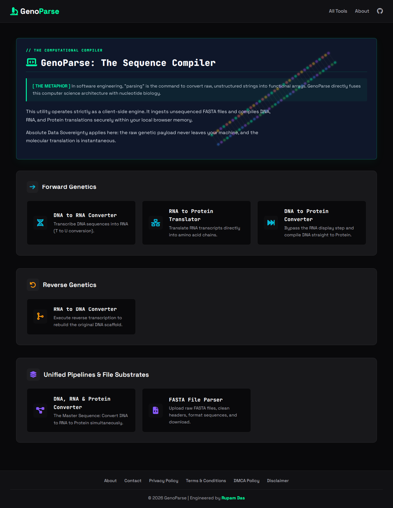

# 🧬 GenoParse: The Sequence Compiler

### // THE COMPUTATIONAL COMPILER
**[ THE METAPHOR ]** In software engineering, "parsing" is the command to convert raw, unstructured strings into functional arrays. GenoParse directly fuses this computer science architecture with nucleotide biology.

This repository functions as a strict client-side engine. It ingests unsequenced FASTA files and compiles DNA, RNA, and Protein translations securely within your local browser memory. 

Because these reactions execute entirely locally without any backend, absolute **Data Sovereignty** is maintained. The raw genetic payload never leaves your machine, and the molecular translation is instantaneous.

---

## 🛠️ The Sequence Catalog

### 🟦 Forward Genetics
- **DNA to RNA Converter:** Transcribe DNA sequences into RNA (T to U conversion).
- **RNA to Protein Translator:** Translate RNA transcripts directly into amino acid chains.
- **DNA to Protein Converter:** Bypass the RNA display step and compile DNA straight to Protein.

### 🟨 Reverse Genetics
- **RNA to DNA Converter:** Execute reverse transcription to rebuild the original DNA scaffold.

### 🟪 Unified Pipelines & File Substrates
- **DNA, RNA & Protein Converter:** The Master Sequence Pipeline. Convert DNA to RNA to Protein simultaneously.
- **FASTA File Parser:** Upload raw FASTA files, clean headers, format sequences in standard 80-character blocks, calculate GC content, and download.

---

## 🔬 The Development Sprint & AI Architecture

I am an undergraduate Microbiology student, not a formally trained computer scientist. 

This entire bioinformatics suite was architected and built in an intense development sprint. Instead of getting bogged down in memorizing vanilla JavaScript syntax or DOM manipulation boilerplate, I leveraged **Google Gemini** as my "junior developer." 

I defined the biological logic (translating the Standard Genetic Code, handling start/stop codons, mapping reading frames), the UI/UX "Bio-Cyber" ecosystem, and the strict privacy parameters (zero-server data processing). Gemini acted as my syntax translator, allowing me to build at the speed of thought. 

The scientific method—running a test, observing the sequence output, refining the prompt, and iterating—is language-agnostic. This project proves that with modern AI, domain experts can architect complex software tools tailored perfectly to their own industry's needs without waiting on external IT departments.

## 🚀 Technical Stack
- **Core Logic:** Vanilla JavaScript (ES6+), HTML5, CSS3.
- **Data Ingestion:** The `FileReader API` for instant, local FASTA file drag-and-drop loading.
- **Data Export:** The `Blob API` for generating structured `.fasta` file downloads entirely client-side.
- **Sanitization Engine:** Aggressive custom Regex algorithms to strip metadata, headers, line breaks, and hidden characters, ensuring pristine nucleotide inputs.
- **UI Design:** Custom "Bio-Cyber" theme utilizing Space Grotesk and JetBrains Mono.

## 💻 Running Locally
Because GenoParse is 100% client-side, there is no backend server or Node.js environment to configure.

1. Clone the repository: `git clone https://github.com/d-rupam/GenoParse.git`
2. Open the directory.
3. Serve using any local web server (e.g., Python: `python -m http.server 5500` or VS Code Live Server).
4. Navigate to `http://localhost:5500`.

## 📄 License
This project is open-source and available under the [MIT License](LICENSE).

---
*Engineered by [Rupam Das](https://rupamdas.in)*
